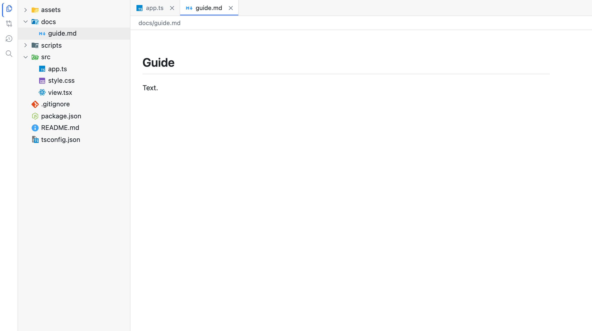
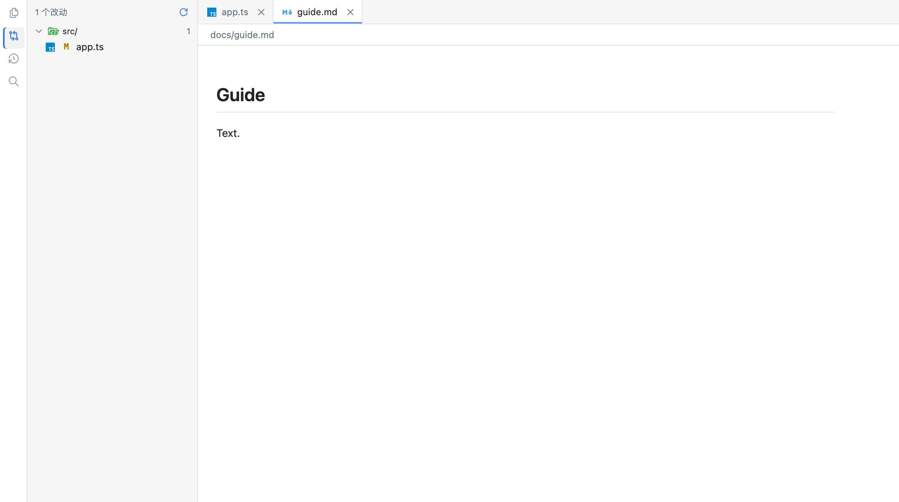
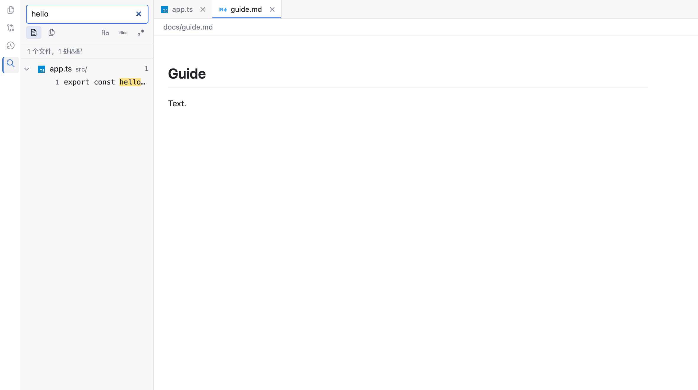

# Diorama

> A live diorama of your files. —— 把你的目录，摆成一个场景。

Diorama 是一个**只读的文件查看器**：在任意目录执行一条命令，这个目录就变成浏览器里一个可以走进去看的场景。文件树、多标签、Markdown、代码高亮、图片、PDF、git 变更与历史、文件搜索——每一样能力都是场景里的一块景片（piece），装上插件就多一块。

名字来自希腊语 **dia-**（穿过）+ **horama**（所见）："透过一个窗口看到的景象"。1822 年 Daguerre 在巴黎造的同名装置让人坐进暗室，看巨幅画面随光线变化而"活"起来——常被视为电影的前身。这个名字同时说了两件事：**你能看见什么**（一条命令，目录变成可看、可走的场景），以及**它是怎么来的**（场景不是画出来的，是一块块景片搭出来的）。完整的候选与撞名检查见 [docs/naming.md](docs/naming.md)。

| 文件树 | 变更 | 搜索 |
|---|---|---|
|  |  |  |

## 功能一览

- **文件树**：彩色文件类型图标；默认隐藏 `.git` 与 `node_modules`（可用 `ignore` 规则覆盖）；大目录分页加载。
- **多标签**：每个文件一个标签页，独立滚动、互不干扰；支持 `mod+alt+←/→` 与 `Ctrl+Shift+Tab` 切换。
- **渲染器**：Markdown（marked + DOMPurify 消毒）、代码高亮（highlight.js）、图片（含 SVG）、PDF（浏览器原生查看器）、HTML（消毒预览与源码双视图，页面脚本逐文件确认后才执行）、纯文本兜底。渲染器失败时自动回退到下一个，绝不白屏。
- **git 只读视图**：左栏「变更」实时显示工作区 diff（由文件 watch 驱动重算）；「历史」浏览提交列表，点开看提交详情、文件清单与「改动 / 提交时的内容」对比。
- **搜索**：按内容（字面量 / 正则、大小写、全字匹配）或按文件名（子序列，VS Code `Ctrl+P` 口径）；点结果直接打开文件并跳到那一行。`mod+p` 随时快速打开文件。不做索引，每次现场扫描，遵守 `ignore` 规则。
- **命令与快捷键**：命令面板（`mod+k`）与快捷键共用一套命令注册表；按 `?` 查看全部快捷键速查。
- **主题**：默认跟随系统明暗（系统切换即时生效），`mod+alt+t` 或命令面板里锁定亮色 / 暗色；选择记在浏览器里、写进 URL（`#theme=dark`），刷新与分享都不闪。第三方插件可以用 `ctx.theme.register({ id, title, scheme, tokens })` 加主题——一组 CSS 自定义属性，不用写 UI 就出现在命令面板里。
- **实时刷新**：文件变化自动更新树与内容（300ms 合并，可在页面里关闭自动刷新）。
- **URL 深链**：`/~/<路径>` 直接打开某个文件，刷新后恢复活动标签；git 视图的 `#diff`、`#history=<sha>` 同样可分享。

**不做的事**：编辑、保存、重命名、删除，git 写操作——Diorama 是只读查看器，被浏览的目录永远不会被写入。

## 快速开始

```bash
npm install -g @diorama-cli/diorama
diorama .
```

输出类似：

```text
diorama serving /path/to/your/project
  http://127.0.0.1:54321/
  config: none (defaults)
  [mount:78853ab4] plugins: slots, layout, file-tree, tabs, renderer-registry, plaintext, markdown, code, image, pdf, html, palette, help, theme, git-changes, search-view
  hidden: .git, node_modules
```

打开打印出的 URL 即可。默认监听 `127.0.0.1` 并随机分配端口；对同一目录重复执行是幂等的，不会重复占用端口。

内置 15 个插件，装完即用，不需要再安装任何东西。发布包是一个整体：内核、UI 原语与全部内置插件都内联在内，运行时依赖只有 `cordis`。

## CLI 命令

```bash
diorama [dir] [options]        # 挂载一个目录（gateway 未运行时自动拉起），打印 URL
diorama ls [--json]            # 列出所有挂载：目录、URL、状态、配置来源
diorama restart <mount|dir>    # 卸载后重新挂载（加载新配置或从故障中恢复）
diorama gateway start|stop|status|restart
diorama gateway run            # 前台运行 gateway
diorama config [show|set|unset]  # 读 / 改 / 交互式生成 diorama.toml
diorama --version
```

`diorama [dir]` 的常用选项：

| 选项 | 说明 |
|---|---|
| `--port <n>` | 指定端口；缺省时先看 `diorama.toml`，再随机分配。显式端口被占直接报错，不重试 |
| `--host <ip>` | 监听网卡；缺省 `127.0.0.1`。需要局域网访问时显式放开 |
| `--plugins <a,b,…>` | 只加载列出的内置插件（其余自动补齐依赖）；用于裁剪场景或调试 |
| `--config <path>` | 指定 `diorama.toml`，跳过默认查找 |
| `--all` | 不隐藏任何条目（等价 `ignore = []`） |
| `--dump-config` / `--dump-plan` | 打印合成后的配置 / 插件启动计划（JSON），用于排查 |
| `--json` | 把挂载输出成**一个** JSON 文档（`url` / `root` / `mountId` / `created` + 完整 `mount`），给脚本用 |
| `--foreground` | 在当前进程前台运行 gateway（调试、测试用） |

### 给其它程序用：`--json`

```bash
$ diorama . --json
{"url":"http://127.0.0.1:54321/","root":"/path/to/project","mountId":"78853ab4","created":true,"mount":{"mountId":"78853ab4",...}}
```

stdout 只有这一个文档，没有人类可读的行；`jq -r .url` 即可拿到地址。`created: false` 表示这个
目录本来就已经挂载（同一 URL），`pluginFailures` 只在插件启动失败时出现（此时退出码 1）。
`diorama restart <dir> --json` 同样可用，另带 `remounted`（被替换掉的旧 mountId）。
失败时 stdout 为空、错误照常走 stderr 与对应退出码——调用方不会把错误当成一次挂载。
`--foreground` 也能配 `--json`：文档照常打印，进程随后照常前台不退出，由包一层的调用方读第一行。

退出码：成功 `0`；参数错误、目录不存在、配置写错为 `2`；端口被占、插件加载失败、连接超时为 `1`；未运行 gateway 时执行 `stop` 是成功的空操作。

## 配置：`diorama.toml`

唯一的配置文件。查找顺序：被服务的目录 → `$DIORAMA_HOME/diorama.toml`（默认 `~/.diorama`）→ 全默认；只读第一个找到的文件。优先级：**CLI 选项 > `diorama.toml` > 默认值**。配置写错会明确报错退出（退出码 2），绝不静默忽略。

```toml
# 全部字段可选
host = "127.0.0.1"          # 监听网卡
port = 0                    # 0 = 随机空闲端口
plugins = [/* 内置客户端插件清单 */]
ignore = [".git", "node_modules"]   # 隐藏规则（gitignore 语法子集；不读 .gitignore）

[watch]
debounceMs = 300            # 文件事件合并窗口（0–60000）
enabled = true              # false 时完全关闭 watch
maxDirectories = 64         # 每个目录同时监听的目录数上限（1–4096）

[git]
maxDepth = 3                # 向下找仓库的层数（0–64）
maxRepos = 32               # 一个挂载最多报多少个仓库（1–4096）

[html]
scripts = false             # HTML 预览是否默认执行页面脚本（默认 false：逐文件确认）
```

### 改配置：`diorama config`

不想手写 TOML 时，用子命令读、改、或者逐项问：

```bash
diorama config                      # 交互式：逐项问，能选的给编号菜单，回车保留，"-" 清除
diorama config show [<dir>] [--json]   # diorama <dir> 会用的配置与来源
diorama config set --port 8080 --ignore ".git,*.log" --watch.enabled false
diorama config unset port            # 删掉一个字段，回到默认
```

- **默认写到 `$DIORAMA_HOME/diorama.toml`**（全局默认）；要写项目里的文件，点名 `--dir <dir>`
  或 `--config <path>`。浏览一个目录永远不往里写东西。
- **只写你选过的字段**，其余行原样保留；写完不会重启正在跑的 mount，生效用 `diorama restart <dir>`。
- 值不合法、或目标文件本身写坏了（语法错、未知键）→ 报错退出 2，**一个字节都不写**。
- **交互式会列候选**：`host` 直接从本机网卡解析（`127.0.0.1` / `0.0.0.0` / 各网卡 IPv4），
  `plugins` / `ignore` / `watch.enabled` 是勾选菜单（方向键 + 空格，或直接打编号）；`port` 这类
  数字项只收数字。候选只是省打字，**打任何值都照常收**。

## 进程模型与安全

- **一个 gateway，多个目录**：整台机器只有一个常驻的 `diorama gateway` 进程；`diorama .` 是短命命令，通过 Unix socket（`~/.diorama/diorama.sock`）通知 gateway 挂载目录并分配端口。gateway 未持久化——重启后挂载清空，重新执行 `diorama .` 即可。
- **目录级故障隔离**：每个目录是独立的插件子树与 HTTP 端口；一个目录的插件故障只把该目录标记为 degraded（页面显示横幅，自动重启一次，也可 `diorama restart <dir>`），不影响其它目录。
- **只读边界**：`ctx.fs` / `ctx.git` 不提供任何写接口；插件禁止直接访问 Node 文件系统，必须走 `ctx.fs`。唯一的写盘位置是工具自己的状态目录 `~/.diorama/`。
- **默认只监听 loopback**：`host` 只能由 `diorama.toml` 或 `--host` 显式放宽。

## 面向开发者

### 仓库结构

```
packages/kernel/          内核：服务端（HTTP/RPC/fs/git/search/config/plan/gateway）
                          与客户端（boot/rpc/fs/tabs/tree/commands/router），shared 类型
packages/plugins/<id>/    内置插件，一包两半边：lib/index.mjs（server）+ lib/client.cjs（页面）
packages/ui/              页面渲染原语：Slot、useKernel、错误边界、样式、图标
packages/cli/             命令行：参数、diorama.toml 合成、服务端插件装配、gateway 控制
apps/web/                 页面壳（Vite）+ Playwright 端到端测试
docs/                     契约、架构、能力清单、逐里程碑实施说明
scripts/                  生成器（图标表；pnpm icons 重新生成）
```

技术栈是 Node/TypeScript 全栈：服务端与客户端各跑一棵 [Cordis](https://github.com/cordisjs/cordis) 插件树，前端用 React（只通过 `useSyncExternalStore` 消费不可变快照），Vite 构建页面壳。**连布局都是插件**——壳只负责持有加载器、按插件图启动、绘制根座位。

### 内置插件

| 插件 | 职责 |
|---|---|
| `slots` | 座位（slot）注册表，所有组合的基础设施 |
| `layout` | 页面骨架：左右分栏、侧栏视图切换器、覆盖层座位 |
| `file-tree` | 左侧文件树视图 |
| `tabs` | 多标签：打开、切换、关闭，每个标签一个内容座位（隐藏不卸载） |
| `renderer-registry` | 按扩展名 → MIME → 内容探测三档派发渲染器，带回退链 |
| `plaintext` | 纯文本兜底渲染器 |
| `markdown` / `code` / `image` / `pdf` / `html` | 各文件类型的渲染器 |
| `palette` | 命令面板（`mod+k`），只列当前可执行的命令 |
| `help` | 快捷键速查表（`?`），列出全部绑定 |
| `theme` | 主题命令（跟随系统 / 亮色 / 暗色，`mod+alt+t`）与每个已注册主题的 `theme.use:<id>` |
| `git-changes` | 左栏「变更」与「历史」视图、diff 与提交详情座位 |
| `search-view` | 左栏「搜索」视图与 `mod+p` 快速打开 |

### 写插件

一个插件是一个 npm 包，`package.json` 里带 `diorama` 字段声明全局唯一的 `id`、兼容的契约版本范围（当前 `>=0.0.4 <0.1.0`）与依赖（`requires`）。一个包可以同时有 **server 半边**（注册服务，有文件系统权限，通过 RPC 暴露给页面）与 **client 半边**（注册座位条目与渲染组件）；两边不共享内存，只通过 RPC 通信。加载时内核校验契约版本，不匹配就拒绝加载并说明原因；任何失败都是 fail loud——大声报错，但只影响它负责的那一块，渲染器有回退链兜底。

关键约束：**文件访问只能走 `ctx.fs`**（只读），插件里禁止 `import 'node:fs'`；协作只走座位（slot）与 Cordis 服务，不做跨插件的值导入。完整的签名、座位清单与匹配规则见 [docs/contract.md](docs/contract.md)；设计动机与已拍板的取舍见 [docs/architecture.md](docs/architecture.md)；能力档位（✅ / 待定 / 明确不做）见 [docs/features.md](docs/features.md)。

### 开发与验证

```bash
pnpm install
pnpm build                 # 全量构建（含各包的类型声明产出）
pnpm test:unit             # node --test，303 条单测
pnpm -r --no-sort run typecheck   # 注意：不要用 pnpm typecheck（任务图成环，会失败）
pnpm --filter diorama-web exec playwright test   # 120 条端到端，真实 CLI + Chromium
```

端到端测试跑的是构建产物（`packages/*/lib`、`apps/web/dist`），改了源码先 `pnpm build` 再跑；每个用例使用独立的 `DIORAMA_HOME` 与 gateway，不碰真实的 `~/.diorama`。

本地试用本仓库的代码：

```bash
pnpm install && ./link.sh
diorama-beta .
```

`link.sh` 通过 `npm link` 把本仓库接到全局，但命令名是 **`diorama-beta`**，永远不会覆盖已安装的 `diorama`。两条通道互不干扰：beta 的 socket、pid、日志文件都带 `-beta` 后缀，`diorama-beta ls` 看不到发布版的挂载，反之亦然。也可以不 link，直接 `node packages/cli/bin/diorama-beta <dir>`，或 `source ./link.sh` 只给当前 shell 加 PATH。

发布：`pnpm pack:prepare`（= 全量构建 + 组装单包）后在 `packages/cli` 里 `npm publish`，产物是 `@diorama-cli/diorama`。组装会把根 `README.md` 拷进包目录（npm 只认包目录里的 README），并把其中的相对链接改写成仓库地址——npmjs.com 上渲染的那一页没有 `docs/` 目录。

### 文档索引

| 文档 | 回答什么 |
|---|---|
| [docs/contract.md](docs/contract.md) | **能不能**：内核与插件的唯一约定（manifest、`ctx.*` 服务、座位、RPC、控制面） |
| [docs/architecture.md](docs/architecture.md) | **为什么**：已拍板的决定、放弃项与代价 |
| [docs/features.md](docs/features.md) | **有什么**：能力清单与档位（✅ / 待定 / 明确不做） |
| [docs/plan.md](docs/plan.md) | 阶段性排期与各里程碑的验收标准 |
| [docs/m0…m14/spec.md](docs/) | 每一档的实施说明与踩坑记录 |

## 状态与许可

- 契约版本 `0.0.4`（pre-1.0 线：破坏性变更以 `0.0.x` 递增表达；插件声明 `>=0.0.4 <0.1.0`）。
- 已实现：文件树、多标签、五类渲染器、git 变更与历史（diff 三档读法：行内 / 整文件单栏 / 新旧双栏）、文件搜索、命令面板与快捷键体系、watch、URL 深链、图标、明暗主题（跟随系统 / 锁定 / 第三方主题注册）、gateway 多目录挂载、`diorama.toml` 配置、挂载的 `--json` 输出、**一个目录里的多个 git 仓库**（并列与嵌套，变更 / 历史按仓库分组）。303 条单测 + 120 条端到端全部通过。
- 尚未做：外部插件加载（`~/.diorama/plugins` 与 npm 来源）、界面语言（i18n）、编辑能力（永远不会做——这是只读查看器）。
- [MIT](LICENSE)
