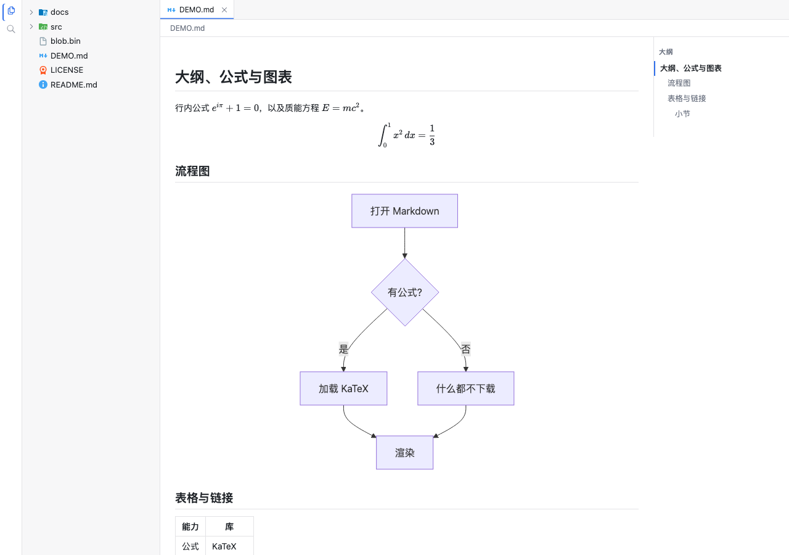

# 实施说明：Markdown 的大纲、公式与图表

> 记录于 2026-10-23。用户要求：**markdown 渲染增强 —— 大纲（outline）、数学公式（KaTeX）、
> mermaid**。契约不升号（§6）：没有新增服务、没有改 `ctx.*` 的签名、**没有加座位**；变的是
> §5.1 里 `markdown` 渲染器的内容规则，以及 §4 里多出的一条 HTTP 路由（`/plugins/<id>/…`）。
> 契约正文补在 **§5.1 / §4**，变更清单在 contract.md **§27**。
>
> **一处返工**：大纲第一版做成了左栏的第六个视图（`sidebar.views`，`mod+alt+5`）。用户指出
> 「outline 只是单个文件的范围，不应该扩展到侧边栏，应该放在页面内部」——见 §6 坑 1。现在它是
> 文章旁边的一栏目录，在这篇文章自己的 tab 里。

## 1. 出发点

`markdown` 原先只做一件事：`marked` 解析 + `DOMPurify` 消毒，把 `.md` 变成 HTML。三件读者
期待的事都没有：

1. **长文档没法导航**。标题有 `id`（`#fragment` 要用），但读者只能靠滚动找位置。
2. **公式是纯文本**。`$e^{i\pi}+1=0$` 原样显示成美元符号里的一段字符。
3. **Mermaid 围栏只是代码块**。一张架构图在页面上是一段没人读的 `graph TD; A-->B`。

三者的共同难点是**体积**：KaTeX 约 280 KB 脚本 + 20 个字体文件（约 300 KB），Mermaid 的
自足包约 3.5 MB。而 client 半边是**自足的闭包**（m0/spec §10.3）：`import` 什么，`client.cjs`
就带上什么，每个打开页面的读者都要下载。绝大多数文档既没有公式也没有图。

验收截图（大纲 + 行内/块公式 + Mermaid，浅色主题）：

## 2. 决定

| 决定 | 取值 | 为什么 |
|---|---|---|
| 解析时做什么 | 只留**占位元素**，源码放**文本**里 | 解析必须是纯函数（`node --test` 能跑），而渲染要等库到位 |
| 库从哪来 | 插件自己的包，`/plugins/markdown/vendor/…` | 半边是闭包，进包就是每次打开页面都付；独立文件还能让 KaTeX 的 CSS 找到自己旁边的字体 |
| 什么时候加载 | 文档里**真有**公式 / 图时，每页一次 | 没有公式的文档一个字节都不下；同一页第二个文档不再付 |
| 在哪渲染 | **挂载之后**，在消毒过的 DOM 上 | 消毒只有一次；公式与图表不是要让消毒器放行的 HTML |
| 源码放哪 | 占位元素的**文本内容** | DOMPurify 会删掉值里含 `-->` 的属性——每张 Mermaid 图都有箭头（§6 坑 1）|
| 失败怎么办 | 留源码 + 一条 `title`；只 warn | 一个写错的公式不该让整段消失，也不该弹窗 |
| 大纲的数据 | 渲染器解析时顺手产出的标题表 | 标题的 `id` 本来就为 `#fragment` 生成，同一份数据 |
| 大纲放哪 | **文章旁边**，在文章自己的 tab 里 | 一个文件的标题不是关于挂载的事实；左栏由所有 tab 共用（§6 坑 1）|
| 大纲何时画 | 标题 **≥ 2** 条 | 一条标题就是读者已经看得见的那个题目，加一栏只是挤掉正文宽度 |
| 大纲的层级 | 最浅的一级为 1，且不跳级 | 从 `##` 开始的文档不该缩进在空气里；`h2 → h4` 不该留一个假空位 |
| 主题 | Mermaid 在 `data-scheme` 变化时**重画** | 颜色画在 SVG 里，不重画就是暗色页挂白图 |

## 3. 语义细则

- **`$` 的判定**（GitHub 口径）：`$` 内两侧不留空格、单行、闭合的 `$` **后面不跟数字**。
  最后一条是给 `$5 和 $6` 留的：不加它，`5 和 ` 会被当成公式。
- **块公式**：`$$` 独占一行（围栏式），或 `$$…$$` 在一行里。两者都是 display math。
- **围栏语言**：`lang` 的第一段是 `mermaid`（大小写不敏感，`mermaid title=…` 也算）。
- **加载器**：两个模块级 Promise（`loadKatex` / `loadMermaid`），失败时清掉以便重试；
  样式表是 `<link id="diorama-katex-styles">`，只插一次。
- **`enhanceArticle(article)`**：看这篇文档要不要库，并行加载，然后 `renderMath` /
  `renderMermaid`；返回的 disposer 只取消**上一次**的挂载（文档换掉时旧的那次不再写 DOM）。
- **幂等**：每个占位元素上有 `data-rendered`，重跑不会渲染两遍。
- **Mermaid 的 id**：每页一个自增计数器（`diorama-mermaid-N`），两个图不撞。
- **失败**：`data-state="error"` + `title` 是 Mermaid 的原话；`<pre>` 里的源码留着。
- **大纲的位置**：`.diorama-markdown-body` 是 `display: flex`，文章在左、目录在右；
  目录 `position: sticky` 跟着滚。**文章 + 目录作为一块整体居中**：放任文章贴左、目录夹在
  右侧留白里，宽屏上正文会被钉在左缘（§6 坑 10）。目录窄（180px）、字号低一档——它是文档的
  **地图**，不是第二栏正文。窄于 900px 时换成一栏，目录落到正文**上面**（`column-reverse`）。
- **大纲的点击**：`scrollIntoView({ block: 'start' })`，**按文章限定查找**——每个 tab 的文章都还
  挂载着，全文档查找会撞上隐藏 tab 里同名 `id` 的那一份。
- **当前小节**：滚动时取「最后一条落在阅读线上方」的标题。阅读线是**滚动框顶 + 24px**，必须**高于**
  标题的落点（`scroll-margin-top: 8px` 让标题停在 +8）：线取 +8 时，刚跳过去的标题正好压在线上，
  浮点误差决定比较结果（§6 坑 3）。
- **大纲的空态**：没有文章（二进制文件）、或标题少于两条时，**不画**这一栏；它不跨 tab 残留，
  因为它根本不是独立的状态，而是这次渲染的一部分。

## 4. 改动清单

| 包 | 改动 |
|---|---|
| `kernel/src/server/http.ts` | `/plugins/<id>/<path>`：从该插件半边所在目录取文件（`serveStatic` 的越界检查照旧）；`<id>` 必须在本次 boot 图里 |
| `plugins/markdown/src/math.ts` | 新文件：`$…$` / `$$…$$` 的 marked 扩展、两个占位元素、`escapeHtml`、`isMermaidFence`。**纯函数** |
| `plugins/markdown/src/enhance.ts` | 新文件：按需加载 KaTeX / Mermaid、`renderMath` / `renderMermaid`、`enhanceArticle`、`watchScheme` / `rethemeMermaid` |
| `plugins/markdown/src/outline.ts` | 新文件：`OutlineEntry`、`plainHeadingText`、`normalizeOutline`、`OUTLINE_MIN_HEADINGS`。**纯函数** |
| `plugins/markdown/src/index.tsx` | `renderDocument`（HTML + 标题表，`renderMarkdown` 保留为薄包装）；`OutlineRail` 组件画在文章旁边（`.diorama-markdown-body`），带当前小节标记；渲染器在 effect 里调 `enhanceArticle`、订阅 `data-scheme` |
| `plugins/markdown/scripts/vendor.mjs` | 新文件：把 `katex.min.css` / `katex.min.js` / 20 个 woff2 / `mermaid.min.js` 拷进 `lib/vendor/`；`build` 脚本在 vite 之后跑它 |
| `plugins/markdown/package.json` | `katex` / `mermaid` 依赖；`build` 加 vendor 一步 |
| `plugins/markdown/test/enhance.test.ts` | 新文件 9 条：占位元素（文本而非属性）、`escapeHtml`、围栏判定、大纲的纯文本与层级 |
| `ui/src/styles.css` | `.diorama-markdown-body`（两栏）、`.diorama-math` / `.diorama-mermaid`、`.diorama-outline*`（sticky 栏、当前小节、窄屏折成一栏）；只用 token，light / dark 共用 |
| `scripts/assemble-package.mjs` | 把插件的 `lib/vendor/` 一起带进发布包 |
| `apps/web/tests/m17-markdown.spec.ts` | 新文件 6 条：公式渲染 + 按需加载、无公式文档**零** vendor 请求、Mermaid 成图、目录列出（且在 tab 里、不在左栏）、点一行滚到位 + 当前小节、每个 tab 各自一份目录 |
| `packages/plugins/layout/src/index.tsx` | 视图切换器：`icon` 是空串时退回标题首字（`iconSvg` 在没装图标表的页面返回 `''`，空 span 是一个看不见的按钮）|
| `docs/contract.md` | §5.1 补公式 / 图表 / 目录的规则；§4 补 `/plugins/<id>/<path>`；新 **§27**（§5.2 不变：目录不进侧栏）|
| `docs/features.md` | P5 补能力；新增 U18（文档内目录）/ U19（公式与图表）|

## 5. 验证

1. `pnpm build`
2. `pnpm test:unit`（327 条，含新的 10 条）
3. `pnpm -r --no-sort run typecheck`
4. `node scripts/assemble-package.mjs`
5. `pnpm --filter diorama-web exec playwright test`（131 条，含新的 6 条）

## 6. 坑

1. **大纲放错了地方**。第一版把它做成左栏的第六个视图（`sidebar.views`，`order: 50`，
   `mod+alt+5`）：左栏是所有 tab 共用的，而标题只是**这一篇**的事实——切 tab 时视图得追着活动
   tab 换内容，还得有「没有标题」的空态，全是为了迁就一个错误的位置。用户的判据一句话：
   **单个文件的范围不该扩展到侧边栏**。改回文章旁边之后，空态消失了（标题少于两条就不画）、
   跨 tab 的残留消失了（它不是独立状态，是这次渲染的一部分）、`mod+alt+5` 与那条命令也一起删了。
   顺带：目录的点击必须**按文章限定查找**——每个 tab 的文章都还挂载着，全文档查 `[id]` 会撞上
   隐藏 tab 里的同名标题。
2. **DOMPurify 会删掉值里含 `-->` 的属性**。第一版把 Mermaid 源码放在 `data-source` 里，
   结果每张图都渲染成 `No diagram type detected matching given configuration for text: `（空串）。
   源码在 `src/purify.ts` 的 `_isUnsafeAttributeValue`：含 `-->` / `]>` 的值一律删，因为它在
   XML 重新解析时能提前关掉注释。公式的 `data-tex` 同样危险（TeX 里可以写 `-->`）。
   **规则：占位元素的源码是文本，永远不是属性。**
3. **`start` 的返回值是相对 `src` 的**。marked 把 `e.slice(1)` 传给 `startInline` 的每个
   `start`，拿回来的数字加 1 才是切点。第一版在缩短的尾巴上循环却返回尾巴里的下标，
   于是段落被切在了错的地方（每个字都成了一个公式）。累积偏移量，别返回尾巴下标。
4. **「当前小节」的阅读线要落在标题落点之下**。标题有 `scroll-margin-top: 8px`，所以
   `scrollIntoView` 之后它的 `top` 正好是滚动框顶 + 8；阅读线也取 +8 时，刚跳过去的标题**压在线上**，
   比较由浮点误差决定——于是点「Second part」，高亮还停在「Math paper」。取 +24 之后稳定。
   这类「跳转与判定用同一个常量」的写法，差一个像素就是错的。
5. **`mermaid` 的 UMD 包不是模块**。`dist/mermaid.min.js` 直接 `globalThis["mermaid"] = …`，
   所以是 `<script src>` 而不是 `import()`；它自带所有依赖（没有 `import(`，不拉 chunks）。
6. **KaTeX 的 CSS 必须和字体一起走**。`katex.min.css` 里的 `url(fonts/…)` 是相对路径；
   只拷 CSS 不拷字体，公式会以错字距渲染（看上去像“字体没加载”）。只拷 woff2（20 个，296 KB），
   样式表里 woff2 排第一，其余格式永远不会被请求。
7. **发布包要带 `lib/vendor/`**。`scripts/assemble-package.mjs` 原本只拷 `client.cjs`；
   不补这一步，`npm i -g` 之后所有公式与图表在浏览器里 404。
8. **Mermaid 的配色画在 SVG 里**。`ctx.theme` 切换只改 `data-scheme`，不重画的话暗色页里
   挂着一张白底图；用 `MutationObserver` 盯这个属性，重画前把 `data-rendered` 清掉。
9. **`iconSvg` 在没装图标表的页面返回 `''`**。切换器原先只判 `icon === undefined`，空串会画出一个
   ``——一个看不见的按钮。现在两种都退回标题首字（contract §5.2 本来就写着
   「缺省用 title 首字」）。新图标进 `scripts/generate-icons.mjs` 的 `BUTTON_ICONS` 后要
   `pnpm icons` 重新生成表，再重建**页面壳**——表是壳装的，不是半边装的。
10. **两栏布局在宽屏上要整体居中**。`justify-content: center` 缺位时，860px 的文章贴着左缘，
    目录夹在右侧的大片空白里——用户读作「大纲占了太多空间」，实际是**剩余宽度全堆在一边**。
    文章的 flex 收缩也要从 `1 1 auto` 改成 `0 1 860px`：窄于「文章 + 目录」时宽度从**正文**里扣
    （1024px 窗口剩 764px 给文章），而不是把目录推出右缘。
